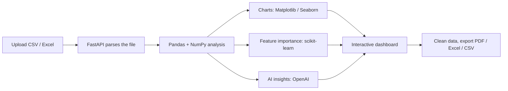

# AutoEDA


**Upload a CSV or Excel file and get a complete exploratory data analysis report in seconds, with no code.**

AutoEDA is a full-stack web app that turns a raw tabular dataset into a clean, interactive dashboard: summary statistics, missing-value analysis, correlations, distributions, outliers, feature importance, and plain-English insights written by AI. You can clean the data right in the dashboard and export a PDF report when you're done.

It pairs a React + TypeScript frontend with a Python FastAPI backend that handles the heavy statistics, chart generation, and AI insights. If the backend isn't running, the frontend falls back to a lightweight in-browser analysis mode, so the app still works.

---

## Technologies

**Frontend**
- React 18, TypeScript, Vite
- React Router v6
- shadcn/ui + Radix UI (accessible components), Tailwind CSS
- Recharts + Chart.js (charts), Framer Motion (animations)
- TanStack React Query + Axios (data fetching)
- PapaParse (CSV) and SheetJS (Excel) for client-side parsing
- jsPDF + jspdf-autotable for client-side PDF export

**Backend**
- Python 3.10+, FastAPI
- Pandas, NumPy (data processing)
- Matplotlib, Seaborn (chart images)
- scikit-learn (feature importance)
- ReportLab (PDF reports)
- OpenAI API (AI-generated insights)

**Testing**
- Frontend: Vitest, Testing Library, Playwright
- Backend: Pytest, httpx

---

## Features

**Upload and detection**
- Drag-and-drop upload for `.csv`, `.xls`, and `.xlsx` files up to 50 MB
- Automatic column type detection (numeric, categorical, date, or empty)

**Analysis**
- Overview dashboard with KPI cards: rows, columns, missing %, duplicates
- Descriptive statistics: mean, median, std, min/max, quartiles
- Missing-value analysis with an interactive heatmap
- Correlation matrix with an interactive heatmap
- Distribution charts for numeric, categorical, and date columns
- Outlier detection with boxplots and flagged records
- Feature importance ranking against a target column you choose
- AI-generated insights: a natural-language summary of the key patterns in your data

**Action**
- Data cleaning: fix missing values, remove duplicates, flag outliers
- Column deep-dive for a focused view of any single column
- Export a PDF report, cleaned data, or Excel/CSV
- Light and dark theme

---

## What Users Can Do

1. **Upload** a dataset by dragging it onto the page.
2. **Pick a target column** (optional) to see which features matter most for it.
3. **Explore** the dashboard tabs: Overview, Statistics, Missing Data, Correlation, Charts, Feature Importance, and Report.
4. **Click any column** to open a detailed view of just that column.
5. **Read the AI insights** for a quick, written summary of what stands out.
6. **Clean the data** by handling missing values, duplicates, and outliers without leaving the dashboard.
7. **Export** a PDF report or the cleaned dataset.
8. **Switch** between light and dark mode.

---

## Keyboard Shortcuts

> **TODO:** Add the shortcuts your app supports, or delete this section if there are none.
>
> | Shortcut | Action |
> |----------|--------|
> | _e.g. `Esc`_ | _e.g. Close the column drawer_ |

---

## The Process

Here's what happens from the moment a file is uploaded to the moment you see results.



1. **Upload:** the React app sends the file to the backend. The backend parses it and creates a **session** (`session_id`).
2. **Analyze:** Pandas and NumPy compute statistics, missing values, correlations, and outliers.
3. **Visualize:** Matplotlib and Seaborn generate chart images, returned to the frontend as base64.
4. **Model:** scikit-learn ranks feature importance against the chosen target column.
5. **Narrate:** the OpenAI API turns the findings into a written summary (optional, needs an API key).
6. **Explore:** the frontend renders everything in the dashboard. Later requests (distribution, outliers, PDF export) reuse the same `session_id` instead of re-uploading.

**Two modes**
- **Full-stack mode (recommended):** the flow above.
- **Frontend-only mode:** if no backend is reachable, `src/lib/analyzeData.ts` computes the core statistics directly in the browser, so the dashboard still works on its own.

---

## How I Built It

I split the project into three layers so each part has one job:

- **Frontend (`src/`):** the landing page and dashboard UI. Each dashboard tab is its own component, and `lib/api.ts` is the single place that talks to the backend.
- **API layer (`backend/routers/eda.py`):** receives requests and passes them to services.
- **Services (`backend/services/`):** one file per responsibility: parsing, analysis, visualization, feature importance, AI insights, and PDF export. This keeps each piece easy to read, test, and replace.

<details>
<summary><b>Project structure</b></summary>

```
autoeda/
├── src/
│   ├── components/
│   │   ├── dashboard/      # Tab components, AIInsights, DataCleaning, ExportMenu, ColumnDrawer, KPICards
│   │   ├── landing/        # Navbar, Hero, Features, HowItWorks, TechStack, Footer
│   │   └── ui/             # shadcn/ui components
│   ├── pages/              # Landing, Dashboard, NotFound
│   ├── lib/
│   │   ├── analyzeData.ts  # client-side analysis engine (fallback mode)
│   │   ├── api.ts          # Axios client for the backend
│   │   ├── pdfCharts.ts    # chart helpers for client-side PDF export
│   │   └── theme.tsx       # light/dark theme provider
│   └── App.tsx             # app root + routing
├── backend/
│   ├── main.py             # FastAPI entrypoint
│   ├── config.py           # env config (file size limit, OpenAI settings)
│   ├── store.py            # in-memory session store
│   ├── routers/eda.py      # all API endpoints
│   ├── services/
│   │   ├── parser.py               # CSV/Excel parsing
│   │   ├── analysis.py             # statistics, correlation, missing data, outliers
│   │   ├── visualization.py        # chart image generation
│   │   ├── feature_importance.py   # scikit-learn ranking
│   │   ├── insights.py             # OpenAI insight generation
│   │   └── export_pdf.py           # PDF report builder
│   ├── tests/              # pytest suite
│   └── requirements.txt
├── vite.config.ts          # dev server + /api proxy
└── package.json
```

</details>

<details>
<summary><b>API reference</b></summary>

In development, requests to `/api/*` are proxied to the backend at `http://127.0.0.1:8000`.

| Method | Endpoint | Description |
|--------|----------|-------------|
| POST | `/upload` | Upload a file (optional `target_column`). Returns the analysis, charts, AI insights, and a `session_id` |
| GET | `/summary` | Column stats, categorical breakdown, dtypes, and shape |
| GET | `/missing` | Missing-value breakdown and heatmap |
| GET | `/correlation` | Correlation matrix and heatmap |
| GET | `/distribution/{column}` | Distribution chart for one column |
| GET | `/outliers` | Outlier records and boxplots |
| POST | `/feature-importance` | Feature importance for a chosen target column |
| GET | `/insights` | AI-generated insights for a session |
| GET | `/export/pdf` | Download the PDF report |
| GET | `/health` | Backend health check |

</details>

---

## What I Learned

> Edit these so they sound like you. These are based on how the project is structured.

- **Designing around sessions.** Storing each upload under a `session_id` means the dashboard can request more analysis without re-uploading the file, and it taught me the trade-offs of keeping that state in memory.
- **Building a graceful fallback.** Writing a second, client-side analysis engine showed me how to make an app degrade instead of break when a service is down.
- **Keeping optional features optional.** The app works fully without an OpenAI key. AI insights are an add-on, not a dependency.
- **Protecting secrets.** The API key lives only in the backend `.env` file, never in the frontend.
- **Separating concerns.** Splitting the backend into small services made it much easier to test each part on its own.

---

## How It Could Be Improved

- Persistent session storage (sessions are currently in memory, so they reset when the server restarts)
- User accounts and saved report history
- More file formats (JSON, Parquet)
- Multi-dataset comparison
- A Docker setup for one-command startup

---

## How to Run

**Prerequisites**
- Node.js 18+ and npm
- Python 3.10+
- An OpenAI API key (optional, only needed for AI insights)

**1. Clone the repository**

```bash
git clone https://github.com/YOUR_USERNAME/autoeda.git
cd autoeda
```

**2. Start the backend**

```bash
cd backend

# Create and activate a virtual environment
python -m venv venv
source venv/bin/activate        # Windows: venv\Scripts\activate

# Install dependencies
pip install -r requirements.txt

# Add your settings
cp .env.example .env            # then add your OPENAI_API_KEY

# Run the API at http://127.0.0.1:8000
python main.py
```

| Variable | Description | Default |
|----------|-------------|---------|
| `OPENAI_API_KEY` | Key used to generate AI insights | _(empty)_ |
| `OPENAI_MODEL` | Model used for insights | `gpt-4o-mini` |

**3. Start the frontend** (in a new terminal, from the project root)

```bash
npm install
npm run dev                     # http://localhost:5000
```

**4. Open the app** at `http://localhost:5000` and upload a dataset.

**Useful commands**

| Command | Description |
|---------|-------------|
| `npm run build` | Production build (output in `dist/`) |
| `npm run preview` | Preview the production build |
| `npm run lint` | Run ESLint |
| `npm run test` | Run frontend tests |
| `pytest` (from `backend/`) | Run backend tests |

**Deploying:** the frontend builds to a static site (Vercel, Netlify, GitHub Pages) and the backend runs on any ASGI host (Render, Railway, Fly.io). When hosting them separately, set `VITE_API_URL` on the frontend to the backend's public URL and update the CORS settings in `backend/main.py`.

---

## Demo Video

[](YOUR_VIDEO_URL)

_A short walkthrough of uploading a dataset and exploring the dashboard._
